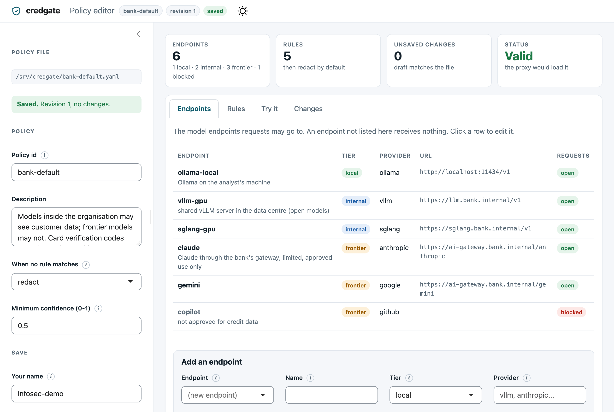
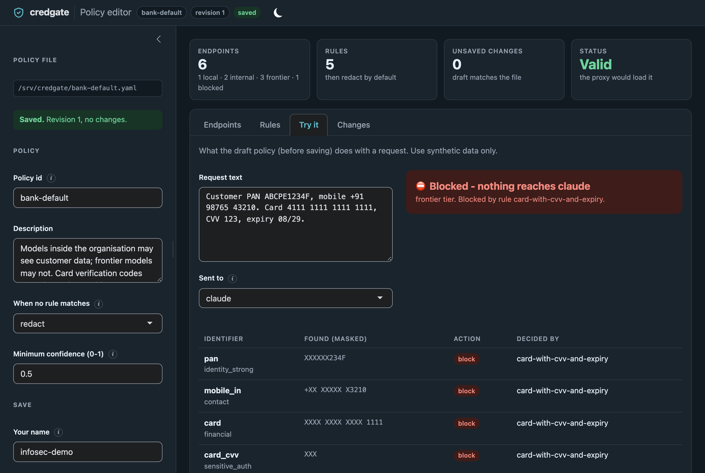

# CredGate

**Governance-first PII detection for LLM requests, with Indian identifiers built in.**

CredGate finds personal data in text and data frames *before* it leaves the
machine for a language model. It is built for data scientists in regulated
Indian environments - banking, insurance, fintech and healthcare - working
under the DPDP Act 2023 and RBI, SEBI and IRDAI expectations, including
fully air-gapped setups.

It ships as an R package and a Python package (with a CLI) that read the same
detection rules, so both languages find exactly the same matches. How the
two compare, name for name: [R and Python](https://dwarpal.github.io/credgate/r-and-python/).

**Documentation:** <https://dwarpal.github.io/credgate/> - the Python API,
the [R package site](https://dwarpal.github.io/credgate/r/), guides and the
shared specification.

> **Status: alpha.** The main path is built and tested, but no one outside
> the project relies on it yet, so formats and APIs may still change.
> Working today: PII detection,
> column scanning (`scan_pii()`), redaction (`redact()`, `preview()`),
> reversible tokenisation (`tokenise()`, `restore()`, with an encrypted
> vault file), policies and the policy editor for InfoSec (R and Python), the
> audit log with monthly rotation and retention, the PII inventory (data
> frames, Spark, BigQuery, databases), and the proxy: OpenAI, Anthropic and
> Ollama APIs with streaming, so Claude Code, VS Code Copilot Chat, Open
> WebUI, ellmer and the SDKs can go through it, on the standard library or
> uvicorn. Next: better detection of names without a cue. credgate will not
> have its own chat assistant: use any tool through the proxy. See
> [DESIGN.md](DESIGN.md) for the roadmap.

## Use it with local LLMs (Ollama, vLLM)

Redact before the prompt reaches the model, whether it runs on Ollama, vLLM
or any OpenAI-compatible server - the model only ever sees placeholders
such as `[PAN]` and `[PERSON_NAME]`.

**Python**

```python
import credgate, ollama

note = "Customer name: Priya Nair. PAN ABCPN1234K, mobile +91 98765 43210, wants the EMI date moved."
print(credgate.preview(note, min_confidence=0.5))   # what will be masked, and why
safe = credgate.redact(note, min_confidence=0.5)    # "Customer name: [PERSON_NAME]. PAN [PAN], mobile [MOBILE_IN], ..."
reply = ollama.chat(model="gemma3:1b", messages=[{"role": "user", "content": f"Summarise: {safe}"}])
```

With **vLLM** (or Ollama's `/v1`, LM Studio, any OpenAI-compatible server):

```python
from openai import OpenAI
client = OpenAI(base_url="http://localhost:8000/v1", api_key="unused")
client.chat.completions.create(model="<served model>",
                               messages=[{"role": "user", "content": credgate.redact(note, min_confidence=0.5)}])
```

**R** (with [ellmer](https://ellmer.tidyverse.org))

```r
library(credgate); library(ellmer)

note <- "Customer name: Priya Nair. PAN ABCPN1234K, mobile +91 98765 43210, wants the EMI date moved."
safe <- redact(note, min_confidence = 0.5)
chat_ollama(model = "gemma3:1b")$chat(paste("Summarise:", safe))
# vLLM: chat_vllm(base_url = "http://localhost:8000/v1", model = "<served model>")
```

**Shell**: `credgate redact notes.txt | ollama run gemma3:1b "Summarise:"`

**Need the real values in the answer?** Tokenise instead of redacting: the
model sees `[PAN_1]`, `[PERSON_NAME_1]`, and `restore()` puts the values back
into its reply.

```python
vault = credgate.Vault()
safe = credgate.tokenise(note, vault, min_confidence=0.5)   # "Customer name: [PERSON_NAME_1]. PAN [PAN_1], ..."
reply = ollama.chat(model="gemma3:1b", messages=[{"role": "user", "content": f"Draft a reply to: {safe}"}])
print(credgate.restore(reply.message.content, vault))      # real name and PAN back in the draft
```

In R: `vault <- cg_vault(); safe <- tokenise(note, vault); restore(answer, vault)`.

Runnable examples (call notes, ticket classification, RAG ingestion, data
frames, shell pipelines) are in [`examples/`](examples/); the R vignette
[Using credgate with local LLMs](pkg/credgate/vignettes/local-llms.Rmd)
walks through the workflow and why it matters even when the model is local
(shared GPU servers, logs, RAG indexes, DPDP data minimisation).

> **Check the preview.** Names are found next to an honorific, relation or
> field label (`Shri`, `S/o`, `Name:`, `नाम:`); a name in running text
> without such a cue ("Customer Priya Nair called") is not detected yet.
> Save the vault (`vault.save(path)`, R `vault_save()`) to restore tokens in
> a later session; it is encrypted with a passphrase. An automatic proxy
> that tokenises and restores for you is next on the roadmap.

## What it detects

| Category | Identifiers |
|---|---|
| Government ID | Aadhaar (Verhoeff checksum), masked Aadhaar, Aadhaar Virtual ID, PAN (with holder type), voter ID (EPIC), passport, driving licence, CKYC number (KIN), ration card number, NREGA job card number |
| Financial | GSTIN (mod-36 check character), payment cards (Luhn + network prefix), card expiry dates, card verification codes (CVV/CVC; always masked in full), UPI IDs, IFSC, bank account numbers |
| Contact | +91 mobile numbers, email addresses, PIN codes |
| Health | ABHA number, ABHA address |
| Personal | Names and postal addresses in Latin and Indic scripts (rule-based, see limits below); every value of a column named for names or addresses (`customer_name`, `nominee`, `नाम`, `permanent_address`, `पता`) |

Every match comes with a confidence score and the reasons for it (checksum
passed, nearby keyword such as "Aadhaar" or "आधार", negative context such as
"order no"). Detection also works through Indic digits (`५४२२ २९३७ ११८२`),
fullwidth characters and zero-width characters hidden inside identifiers.

Add your own formats - account numbers, customer ids, or names found from
the words around them - in a YAML file that R, Python, the command line,
policies and the proxy all load: see [custom detectors](docs/custom-detectors.md).

## Quick start

**R**

```r
library(credgate)

x <- detect_pii("Name: Priya Nair; PAN: ABCPN1234K; UPI: priya.n@oksbi")
x
#> 3 PII matches (values masked; use `x$value` to see them):
#>  doc start end        type         value confidence
#>    1     7  16 person_name    XXXXX XXXX       0.80
#>    1    24  33         pan    XXXXXX234K       0.97
#>    1    41  53      upi_id XXXXX.X@Xksbi       0.99
```

**Python**

```python
import credgate

for span in credgate.detect_pii("आधार: ५४२२ २९३७ ११८२, मोबाइल 9468451273"):
    print(span)
# Span(doc=0, start=6, end=20, type='aadhaar', value='XXXX XXXX ११८२', confidence=0.97)
# Span(doc=0, start=29, end=39, type='mobile_in', value='XXXXXX1273', confidence=0.93)
```

**Scanning a table** (R `scan_pii(df)`, Python `credgate.scan_pii(df)`)
reports which columns hold PII without sending anything anywhere:

```text
Scanned 2 columns; PII found in 2: cust_pan and notes
   column      type rate matched whole confidence      example
 cust_pan       pan 100%  3 of 3     3       0.97   XXXXXX234F
    notes   aadhaar  33%  1 of 3     0       0.97 XXXXXXXX1182
```

**Command line**

```sh
credgate detect notes.txt                      # masked report
credgate detect --lines --json customers.csv   # one JSON object per match
credgate scan customers.csv                    # which columns hold PII
credgate redact notes.txt > notes.redacted.txt  # replace PII with [PAN] etc.
credgate preview notes.txt                     # what would be redacted, and why
git diff --cached | credgate detect --fail     # non-zero exit if PII is found
```

Values are masked whenever results are printed; the real values are only
available programmatically (`x$value`, `span.value`) or with `--reveal`.

## Policies

A policy says, per destination, what happens to each kind of identifier:
let it through, redact it, tokenise it, or block the whole request. It is a
YAML file owned by InfoSec and compliance, and the same file works in R and
Python. It is also the register of model endpoints: each has a tier -
`local` (the analyst's machine), `internal` (open models the organisation
runs, such as vLLM or SGLang) or `frontier` (Claude, OpenAI, Gemini, also
through the organisation's own gateway) - a provider and URL, and can be
`blocked`; an endpoint that is not listed receives nothing. Rules can target
tiers or particular endpoints. See
[`examples/policies/bank-default.yaml`](examples/policies/bank-default.yaml):
in-house models may see customer data (but not government IDs on the shared
GPU server), frontier models may not, a card number with its CVV and expiry
is never sent to a frontier model, card verification codes never leave, and
Copilot is blocked.

```python
policy = credgate.Policy.load("bank-default.yaml")
decision = policy.apply(messages, "claude")   # destination named in the policy
if decision.allowed:
    send(decision.texts)
else:
    print(decision.blocked_by)                # e.g. ('card-with-cvv-and-expiry',)
```

In R: `policy_apply(cg_policy("bank-default.yaml"), messages, "claude")`.
Everything is checked when the policy is loaded - an unknown field, tier,
action or identifier type is an error, never a silent "allow" - and every
decision names the policy revision and the rule behind each action, ready
for the audit log. The format is specified in [spec/README.md](spec/README.md#policies-policy).

InfoSec can change a policy in a browser instead of editing YAML:
`credgate::policy_editor("bank-default.yaml")` in R (needs `shiny` and
`bslib`), or `credgate editor --policy bank-default.yaml` in Python
(`pip install 'credgate[editor]'`) - the same app on the same files. It edits endpoints and rules, tries sample text against the unsaved
policy, shows what changed, and saves only a valid policy, recording who
saved it, why and what changed in a hash-chained change log. Policy tests
kept beside the policy - sample requests and what must happen to them - run
in the editor before every save and with `credgate policy test` in CI. See
[docs/policy-editor.md](docs/policy-editor.md).

<p align="center">
  
  
</p>

## Proxy

The proxy puts the policy between people's tools and the model endpoints:
tools talk to it as to an OpenAI-compatible, Anthropic or Ollama server
(Claude Code, VS Code Copilot Chat with its own models, Open WebUI, the SDKs),
and every request is allowed, redacted, tokenised or blocked by the policy,
recorded in the audit log, and tokenised values are put back into the answer
as it streams. It runs on each
analyst's machine or, with per-user keys, as a shared server; it needs only
the Python standard library.

```sh
credgate proxy serve --policy bank-default.yaml --audit audit.jsonl
# then, in any OpenAI-compatible client: base_url http://127.0.0.1:8790/v1,
# model "vllm-gpu/llama-3.1-70b" (endpoint/model)
```

One worker process checks about 40 requests of 5 KB (or 300 short messages)
per second on a 2019 laptop core, adding a few milliseconds per request;
`--workers N` uses more cores, and instances can run behind a load balancer
(`/healthz`, graceful drain). Latency and throughput under load:
[benchmark/README.md](benchmark/README.md#proxy-throughput). See the
[proxy guide](docs/proxy.md).

## Audit log

Every policy decision can be recorded in an append-only audit log: who sent
which kinds of data to which endpoint, under which policy revision and rule,
allowed or blocked - never the text or the values. Each record holds the
hash of the one before, so editing, deleting, inserting or reordering
records is detected; keep copies of the latest hash (the head) elsewhere to
detect records removed from the end. With an audit key, identifiers are
recorded as keyed hashes, so an investigator with the key can check whether
a given PAN went to a given model; card verification codes are never
recorded in any form.

```python
log = credgate.AuditLog("audit.jsonl")             # key from CREDGATE_AUDIT_KEY, if set
policy.apply(messages, "claude", audit=log)       # recorded, allowed or blocked
credgate.audit_verify("audit.jsonl")              # intact? and the head hash
```

In R: `log <- cg_audit_log("audit.jsonl")`, `policy_apply(..., audit = log)`,
`audit_verify()`, `audit_read()`. R and Python write and verify the same
files.

Logs can **rotate monthly** (`AuditLog(path, rotate=True)`,
`cg_audit_log(path, rotate = TRUE)`): each month's records go to their own
file, and the chain runs on across files, so a deleted or altered month is
detected like an edited line. **Retention**: `audit_prune(path, keep_years =
5)` removes months past the retention period (at least 1 year) - only the
oldest, and never from a log that fails verification - and records what it
removed so the rest still verifies. The proxy rotates monthly and keeps 5
years by default.

## PII inventory

Discovery at scale starts with an inventory: which tables and columns hold
which kinds of personal data. `pii_inventory()` scans a table with the
`scan_pii()` rules and records every column - also those where nothing was
found, so the inventory shows what was covered - with the source, table,
sample size and when it was scanned. It never records values, not even
masked ones. Inventories of many tables are combined and saved as a CSV
file that R and Python write identically.

```python
inv = credgate.pii_inventory(customers, source="crm", table="customers")
inv += credgate.pii_inventory(calls, source="crm", table="calls")
inv.write("inventory.csv")                       # credgate.read_inventory() reads it back
```

In R: `pii_inventory(customers, source = "crm", table = "customers")`,
combined with `rbind()`, saved with `write_inventory()` and read with
`read_inventory()`.

Spark tables work the same way, from PySpark and sparklyr: the table is
sampled inside the cluster and only the sample reaches the driver, so
Hadoop and Hive data can be inventoried where it lives.

```python
df = spark.table("crm.customers")
inv = credgate.pii_inventory(df, source="hive", table="crm.customers")
```

```r
customers <- dplyr::tbl(sc, "customers")              # sc from sparklyr::spark_connect()
inv <- pii_inventory(customers, source = "hive", table = "crm.customers")
```

BigQuery tables are sampled by BigQuery itself, and only the sample is
downloaded. Only the columns credgate can scan are read, and a dry run
checks every query's cost first: anything estimated above `max_bytes`
(default 1 GB) is refused before it runs.

```python
from credgate import bigquery as cgbq
inv = cgbq.inventory_dataset(client, "my-project.crm")     # every table in a dataset
```

In R, with bigrquery: `bq_pii_inventory("my-project.crm.customers")`,
`bq_inventory_dataset("my-project.crm")`, `bq_scan_pii()`. A script to
check it against real BigQuery, in the free sandbox, is in
[`examples/bigquery/`](examples/bigquery/).

Whole databases - Postgres, DuckDB, SQLite, MySQL, IBM Db2 and others - are
inventoried table by table through a connection (SQLAlchemy in Python, DBI
in R). Each table is sampled by the database where it can (`TABLESAMPLE`,
or a reservoir sample in DuckDB); otherwise its first rows are read, and the
inventory says so. With an inventory file, an interrupted scan continues
where it stopped, and later runs rescan only tables that changed.

```python
from credgate.database import inventory_database
inv = inventory_database(engine, source="postgres:crm", path="inventory.csv")
```

```r
inv <- inventory_database(con, source = "postgres:crm", path = "inventory.csv")
```

## Large data

credgate works on tables too big for memory, in both languages and on the
command line:

| | Python | R |
|---|---|---|
| Parquet | `credgate.arrow.redact_parquet()` | `redact_parquet()` |
| DuckDB | SQL: `SELECT cg_redact(notes) FROM 'calls.parquet'` | `redact_query()`, `scan_pii(dplyr::tbl(con, ...))` |
| Polars | `pl.col("notes").credgate.redact()` | - |
| Arrow, pandas | Series, arrays, tables, datasets | arrays, tables, datasets |
| Other databases | any SQLAlchemy database: `credgate.database.redact_query()` | any DBI database: `redact_query()`, dbplyr |
| Spark | `scan_pii(df)`, `pii_inventory(df, ...)` | `scan_pii(tbl)`, `pii_inventory(tbl, ...)` (sparklyr) |
| BigQuery | `credgate.bigquery.pii_inventory()`, `inventory_dataset()` | `bq_pii_inventory()`, `bq_inventory_dataset()` |
| Whole databases | `credgate.database.inventory_database()` (SQLAlchemy) | `inventory_database()` (DBI) |

```sh
credgate scan calls.parquet
credgate redact --parquet calls.parquet --column notes -o calls_safe.parquet
```

`scan_pii()` reads big tables one column at a time and gives the same report
as in memory. The [large-data guide](docs/large-data.md) explains the
approach with Python, R and command-line examples; runnable versions are in
[`examples/`](examples/README.md#large-data-parquet-polars-duckdb-arrow), and
the R vignette `vignette("large-data", package = "credgate")` walks through
it. Throughput is measured in [benchmark/README.md](benchmark/README.md#throughput).

## Installation

**Python** is on PyPI; the **R** package is under CRAN review, so install it
from [R-universe](https://dwarpal.r-universe.dev) or GitHub for now.

**Nix** (recommended; works offline once built):

```sh
nix build github:dwarpal/credgate#credgate      # CLI + Python package
nix build github:dwarpal/credgate#credgate-r    # R package
nix develop github:dwarpal/credgate             # R + Python dev shell
```

**R**

```r
# Development version, prebuilt for Windows, macOS and Linux (R-universe):
install.packages("credgate",
  repos = c("https://dwarpal.r-universe.dev", "https://cloud.r-project.org"))

# or from GitHub (needs build tools on Windows and macOS):
# install.packages("remotes")
remotes::install_github("dwarpal/credgate", subdir = "pkg/credgate")
```

**Python** (3.11+)

```sh
pip install credgate
pip install 'credgate[server]'   # the proxy on uvicorn, for a shared proxy
```

## Accuracy, and how it compares

credgate, MaskFlow, Microsoft Presidio and Kavach PII on two public Indian
PII datasets and on credgate's own corpus - every tool at its default
settings, the same scoring rules for all:

| F1 (overlap) | Ylemis India-PII | IndiaPII-Bench | credgate corpus | PII-free documents flagged | Docs/s | Memory |
|---|---:|---:|---:|---:|---:|---:|
| **credgate** | 67.0 | **95.9** | **98.0** | **0%** | 1,050-2,800 | 35 MB |
| MaskFlow | **79.6** | 77.0 | 71.3 | 8% | 50-130 | 175 MB |
| Presidio, India-configured | 63.6 | 43.6 | 47.9 | 62% | 63-120 | 750 MB |
| Presidio, default | 52.6 | 35.6 | 41.0 | 38% | 57-114 | 670-750 MB |
| Kavach PII | 52.8 | 69.2 | 56.9 | **0%** | 3,000-8,700 | 20 MB |

<sub>**About the data:** all three datasets are synthetic. The
[Ylemis India-PII Benchmark](https://huggingface.co/datasets/Pranshurs/ylemis-india-pii-benchmark)
(10,000 documents, 9 Indian languages; CC0) is written by a PII model
vendor; [IndiaPII-Bench](https://huggingface.co/datasets/maskflow-ai/indiapii-bench)
(2,000 documents; CC BY 4.0, MaskFlow project) by MaskFlow's authors; the
[credgate corpus](benchmark/corpus/) (700 held-out documents) by us. Each
favours its author's approach, so read the columns together. "PII-free
documents flagged" is on Ylemis's 1,756 documents without PII. credgate at
its recommended `min_confidence = 0.5`; one 2019 laptop; speed is the median
of three runs. Method, per-type results and caveats:
[benchmark/external/](benchmark/external/README.md).</sub>

**Where credgate is strong.** Indian identifiers - Aadhaar, PAN, GSTIN, IFSC,
UPI, ABHA, passport, driving licence, bank accounts, cards, phones, and voter
IDs written with a word such as "voter" - found at or near 100% on every
dataset, almost without false alarms; addresses in the usual Indian shape
(house number, locality, city, PIN code) with or without a label; 15-25
times the speed of the tools that run a language model, in a fraction of the
memory.

**Where others do better.**

- **Names without a cue**: MaskFlow and Presidio run spaCy's named-entity
  models, and MaskFlow also matches a list of 114,000 Indian names; they find
  90-99% of Ylemis's names ("Delivery to Sandeep Pillai"). credgate finds
  names after a title, label or relation ("Smt.", "Name:", "S/o"), in
  columns named for names, and with the example custom detector
  [`names-by-cue.yaml`](docs/custom-detectors.md) from cues such as "X
  called" - but only 1.6% (4.9%) of Ylemis's names. That is why it trails on
  Ylemis; organisations can add their own name lists as custom detectors.
- **Vehicle registration numbers**: MaskFlow and Presidio find them;
  credgate does not yet.
- **Bare voter IDs and CKYC numbers** with no word such as "voter" or "CKYC"
  nearby are reported below 0.5 by design (the format alone could be a
  product code).
- **Breadth**: Presidio covers international IDs (US, UK, EU, ...), IBAN, IP
  addresses, URLs, dates and more, can hash or encrypt values, redacts
  images (OCR), and has years in production and many languages; credgate is
  alpha and India-focused.

A second, detailed comparison with Presidio on credgate's corpus (exact
spans, thresholds tuned on a separate dev split) is in
[benchmark/README.md](benchmark/README.md#comparison-with-microsoft-presidio).
The comparisons are independent and not affiliated with any of the projects
compared.

On its own corpus credgate is scored on all 22 types it covers, including
CKYC, ration card and NREGA job card numbers, card verification codes and
expiry dates, which none of the other tools detects. The corpus and its
templates are ours, and rules were refined on its dev split, so expect lower
numbers on unseen text - as the Ylemis column shows. R and Python give
identical results.

## Repository layout

| Path | Contents |
|---|---|
| [`spec/`](spec/) | The shared detection spec: every detector, engine parameters and the conformance cases both packages must pass. A compliance reviewer reads and approves these rules once, for every language. |
| [`pkg/credgate/`](pkg/credgate/) | R package |
| [`pkg/python/`](pkg/python/) | Python package and `credgate` CLI |
| [`benchmark/`](benchmark/) | Synthetic labelled corpus, generator and accuracy report |
| [`flake.nix`](flake.nix) | Nix packages, sandboxed test checks and dev shell |
| [`DESIGN.md`](DESIGN.md) | Architecture, roadmap and design decisions |
| [`tools/sync-spec.sh`](tools/sync-spec.sh) | Copies `spec/` into both packages after an edit |

## Development

```sh
nix develop                 # R, Python, ruff, test tools
nix flake check             # R tests, Python tests (3.11/3.13/3.14), ruff, spec sync
```

After editing anything in `spec/`, run `tools/sync-spec.sh` and add a
conformance case in `spec/conformance/detect.yaml`; both test suites run
those cases. All test data is synthetic (`synth_indian_pii()`); never commit
real personal data.

## Masked output

Wherever credgate *shows* a detected value (printed matches, `preview()`,
`scan_pii()` examples, the command line), it masks it:

| Value | Shown as |
|---|---|
| Identifiers (Aadhaar, PAN, mobile, account, card, ...) | last 4 characters kept: `XXXX XXXX 1182`, `XXXXXX234F` |
| Names and addresses | masked in full: `XXXXX XXX` |

Keeping the last 4 characters lets you check which value matched, and stays
within the display limits of UIDAI's masked Aadhaar and PCI DSS (cards). If
your policy allows no part of a value to be shown, mask everything:

```r
options(credgate.mask = "full")   # R
```

```python
credgate.set_mask("full")         # Python
```

or the environment variable `CREDGATE_MASK=full` for both, and the command
line.

Masking changes only what is displayed; detection and `redact()`
(`[AADHAAR]`, `[PERSON_NAME]`) are unaffected.

## Security

credgate runs entirely offline: no network calls, telemetry or downloads.
Secrets (vault passphrases) come only from arguments, environment variables
or a prompt, and detected values are masked whenever credgate shows them.
The [threat model](docs/threat-model.md) sets out what credgate protects,
against whom, what it trusts and where it does not protect, for InfoSec and
compliance reviews. Please report security issues privately, as described
in [SECURITY.md](SECURITY.md), rather than in a public issue.

## Known limits

- In running text, names are found only next to a cue: an honorific (Shri,
  Smt, श्रीमती, or "ji" after the name), a relation (S/o, D/o) or a field
  label (`Name:`, `नाम:`). Addresses are found after a label, after a house
  or village keyword, or in the usual shape - house number, locality, a
  known Indian city or district, PIN code. A deity addressed with "ji" ("Ram
  ji") is taken as a name.
  Where you know a column or value holds names or addresses, say so - a
  column named for them, or `context = "customer name"` - and every value is
  read as one. For names in notes with other cues ("Lakshmi Verma called"),
  load the example custom detector `examples/detectors/names-by-cue.yaml`
  ([custom detectors](docs/custom-detectors.md)).
- CKYC numbers are found only next to a cue ("CKYC", "KIN"), since any
  14-digit number could be one. Ration card numbers have no national format
  and NREGA job card numbers vary by state: those detectors follow the
  published structure and the labels people use, and should be checked
  against samples of your own data.
- A voter ID format (3 letters, 7 digits) without a nearby cue such as
  "voter" or "EPIC" is reported with low confidence (0.3): it could equally
  be a product code.
- A random number can pass a checksum by chance, so a bare 12-digit number is
  reported as a possible Aadhaar with lower confidence; use the confidence
  and reasons to decide.
- The mapping to DPDP, RBI, SEBI and IRDAI obligations (planned for policies)
  is informational, not legal advice.

## Maintainers

- Bharat Sikka ([@bharatsikka](https://github.com/bharatsikka))
- Aishwarya Bais ([@aishwaryabais](https://github.com/aishwaryabais))

## Citing credgate

If you use credgate in your work, please cite it, and say which package
(R or Python) and version you used. GitHub's **Cite this repository**
button (from [CITATION.cff](CITATION.cff)) gives APA and BibTeX; in R,
`citation("credgate")` prints the reference.

Sikka B, Bais A (2026). *credgate: Detect Indian Personal Data Before It
Reaches Language Models.* Python package version 0.5.0.
https://github.com/dwarpal/credgate

```bibtex
@Manual{credgate,
  title  = {{credgate}: Detect Indian Personal Data Before It Reaches Language Models},
  author = {Bharat Sikka and Aishwarya Bais},
  year   = {2026},
  note   = {Python package version 0.5.0},
  url    = {https://github.com/dwarpal/credgate},
}
```

## Licence

Apache License 2.0; see [LICENSE](LICENSE). The licences of every dependency, for
legal and procurement reviews: [Licences](https://dwarpal.github.io/credgate/licences/).
