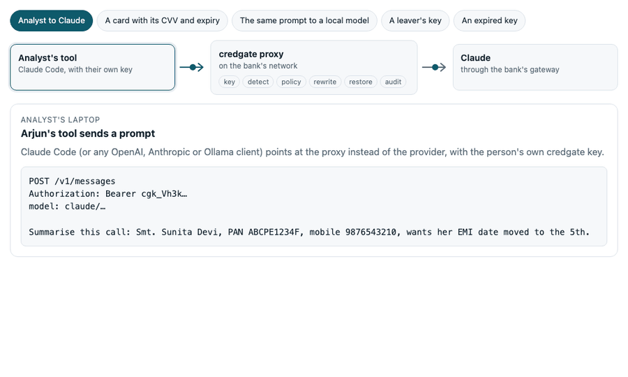

# CredGate

**Keep Aadhaar, PAN and other Indian personal data out of LLM prompts - and prove it.**

[](https://pypi.org/project/credgate/)
[](https://dwarpal.r-universe.dev/credgate)
[](https://github.com/dwarpal/credgate/actions/workflows/ci.yml)
[](https://dwarpal.github.io/credgate/)
[](LICENSE)

credgate finds personal data in text and tables *before* it reaches a
language model, replaces it as your policy says, and records every decision
in a tamper-evident audit log. It is built for data and AI teams in Indian
banking, insurance, fintech and healthcare working under the DPDP Act 2023
and RBI, SEBI and IRDAI expectations - and it runs fully offline, so it
works air-gapped.

```python
import credgate

note = "Customer name: Priya Nair. PAN ABCPN1234K, mobile +91 98765 43210, wants the EMI date moved."
credgate.redact(note, min_confidence=0.5)
# 'Customer name: [PERSON_NAME]. PAN [PAN], mobile [MOBILE_IN], wants the EMI date moved.'
```

The same in R (`redact(note, min_confidence = 0.5)`) and on the command line
(`credgate redact notes.txt`) - one shared specification, identical results.

## Put it in front of Claude Code, Copilot and Ollama

<p align="center">
  <a href="https://dwarpal.github.io/credgate/how-it-works/">
    <picture>
      <source media="(prefers-color-scheme: dark)" srcset="docs/images/proxy-walkthrough-dark.gif">
      
    </picture>
  </a>
  <br><sub>One request, step by step. Interactive, with more scenarios and how a match is scored: <a href="https://dwarpal.github.io/credgate/how-it-works/">How it works</a>.</sub>
</p>

The proxy sits between people's tools and the model endpoints. Claude Code,
VS Code Copilot Chat, Open WebUI and the OpenAI, Anthropic and Ollama SDKs
talk to it as they would to the provider; every request is allowed,
redacted, tokenised or blocked by the policy, tokens are put back into the
answer as it streams, and the audit log records what happened - never the
text.

```sh
pip install credgate
curl -O https://raw.githubusercontent.com/dwarpal/credgate/main/examples/policies/quickstart.yaml
credgate proxy serve --policy quickstart.yaml --audit audit.jsonl --default-endpoint claude
ANTHROPIC_BASE_URL=http://127.0.0.1:8790 claude
```

[`quickstart.yaml`](examples/policies/quickstart.yaml) tokenises identity
numbers for Claude and OpenAI, redacts contact and personal details, blocks a
card sent with its CVV, and lets a model on your own machine see everything.
For an organisation's own setup - internal model servers, a gateway - start
from [`bank-default.yaml`](examples/policies/bank-default.yaml).

Run it on each analyst's machine, or as a shared server where each person
has their own key that expires. See the [proxy guide](https://dwarpal.github.io/credgate/proxy/)
and the walkthrough [Using Claude Code on Indian bank data](https://dwarpal.github.io/credgate/blog/claude-code-without-a-pan/).

## Why credgate

- **Indian identifiers, done properly.** Aadhaar (Verhoeff checksum), PAN,
  GSTIN, cards (Luhn), UPI, IFSC, bank accounts, voter ID, passport, driving
  licence, ABHA, CKYC, mobile numbers, names and addresses - in Latin and
  Indic scripts, through Indic digits and hidden characters. Every match has
  a confidence and the reasons for it.
- **A policy InfoSec owns.** Which endpoints may receive what, per tier
  (your laptop, in-house models, frontier models); tested before every save,
  edited in a browser with roles for admins, auditors and users, and enforced
  by the proxy.
- **Evidence.** A hash-chained audit log of every decision, without the data
  itself; edited or deleted records are detected.
- **Where the data lives.** Data frames, Parquet, DuckDB, Spark, BigQuery and
  databases, sampled in place; a PII inventory of every column.
- **R and Python, one spec.** The same matches, files and decisions in both
  languages ([name for name](https://dwarpal.github.io/credgate/r-and-python/)),
  with permissive licences throughout ([licences](https://dwarpal.github.io/credgate/licences/)).

## Install

```sh
pip install credgate                 # Python 3.11+, with the `credgate` command
pip install 'credgate[editor]'       # the policy editor (Shiny for Python)
```

```r
# R: prebuilt for Windows, macOS and Linux (the CRAN release is under review)
install.packages("credgate",
  repos = c("https://dwarpal.r-universe.dev", "https://cloud.r-project.org"))
```

With Nix: `nix build github:dwarpal/credgate#credgate` (Python and the CLI)
or `#credgate-r`.

## What it detects

| Category | Identifiers |
|---|---|
| Government ID | Aadhaar (Verhoeff checksum), masked Aadhaar, Aadhaar Virtual ID, PAN (with holder type), voter ID (EPIC), passport, driving licence, CKYC number (KIN), ration card number, NREGA job card number |
| Financial | GSTIN (mod-36 check character), payment cards (Luhn + network prefix), card expiry dates, card verification codes, UPI IDs, IFSC, bank account numbers |
| Contact | +91 mobile numbers, email addresses, PIN codes |
| Health | ABHA number, ABHA address |
| Personal | Names and postal addresses in Latin and Indic scripts (rule-based); every value of a column named for names or addresses |

Add your own formats - loan accounts, customer ids, staff codes - in a YAML
file that R, Python, policies and the proxy all load:
[custom detectors](https://dwarpal.github.io/credgate/custom-detectors/).

## How it compares

credgate, MaskFlow, Microsoft Presidio and Kavach PII on two public Indian
PII datasets and on credgate's own corpus, each at its default settings:

| F1 (overlap) | Ylemis India-PII | IndiaPII-Bench | credgate corpus | PII-free documents flagged | Docs/s |
|---|---:|---:|---:|---:|---:|
| **credgate** | 67.0 | **95.9** | **98.0** | **0%** | 1,050-2,800 |
| MaskFlow | **79.6** | 77.0 | 71.3 | 8% | 50-130 |
| Presidio, India-configured | 63.6 | 43.6 | 47.9 | 62% | 63-120 |
| Presidio, default | 52.6 | 35.6 | 41.0 | 38% | 57-114 |
| Kavach PII | 52.8 | 69.2 | 56.9 | **0%** | 3,000-8,700 |

credgate finds Indian identifiers at or near 100% almost without false
alarms, 15-25 times faster than the tools that run a language model. It
trails on names written without a cue ("Delivery to Sandeep Pillai"), which
the others find with named-entity models - add your own name lists as a
custom detector. All three datasets are synthetic and each favours its
author; the method and per-type results are in
[benchmark/external/](benchmark/external/README.md), and the story in
[the benchmark post](https://dwarpal.github.io/credgate/blog/indian-pii-benchmarks/).

## Learn more

| | |
|---|---|
| [How it works](https://dwarpal.github.io/credgate/how-it-works/) | A request through the proxy, and how a match is scored - interactive |
| [Features in detail](https://dwarpal.github.io/credgate/features/) | Every feature with R, Python and command-line examples: local LLMs, tokens, policies, the audit log, inventories, large data, masking, known limits |
| [Proxy](https://dwarpal.github.io/credgate/proxy/) and [deployment](https://dwarpal.github.io/credgate/deployment/) | Running it for one person or a whole team, behind single sign-on |
| [Policy editor](https://dwarpal.github.io/credgate/policy-editor/) | The browser app for InfoSec, in R and Python |
| [Large data](https://dwarpal.github.io/credgate/large-data/) | Parquet, DuckDB, Spark, BigQuery and databases |
| [Threat model](https://dwarpal.github.io/credgate/threat-model/) | What credgate protects, against whom, and where it does not |
| [Specification](https://dwarpal.github.io/credgate/spec/) | The rules both packages follow, with conformance cases |
| [Python API](https://dwarpal.github.io/credgate/python/) and [R reference](https://dwarpal.github.io/credgate/r/) | Every function |

## Status and feedback

credgate is **alpha**: the main path is built and tested, but formats and
APIs may still change, and we are looking for the first teams to use it.
What comes next, and why things are built as they are:
[design and roadmap](DESIGN.md). Feedback is the most useful thing you can
give us:

- **Something missed or wrongly flagged?** Open a
  [detection problem](https://github.com/dwarpal/credgate/issues/new?template=detection.yml)
  with a synthetic example - these directly improve the rules.
- **Something broken, or a feature you need?** A
  [bug report](https://github.com/dwarpal/credgate/issues/new?template=bug.yml)
  or [feature request](https://github.com/dwarpal/credgate/issues/new?template=feature.yml).
- **Trying it at your organisation, or have a question?** Start a
  [discussion](https://github.com/dwarpal/credgate/discussions).

Never paste real personal data into an issue. Security problems:
see [SECURITY.md](SECURITY.md). Contributions are welcome:
[CONTRIBUTING.md](CONTRIBUTING.md).

## Maintainers

- Bharat Sikka ([@bharatsikka](https://github.com/bharatsikka))
- Aishwarya Bais ([@aishwaryabais](https://github.com/aishwaryabais))

If you use credgate in your work, please cite it: GitHub's **Cite this
repository** button gives APA and BibTeX, and in R `citation("credgate")`.

## Licence

Apache License 2.0; see [LICENSE](LICENSE). The licences of every dependency,
for legal and procurement reviews: [Licences](https://dwarpal.github.io/credgate/licences/).
