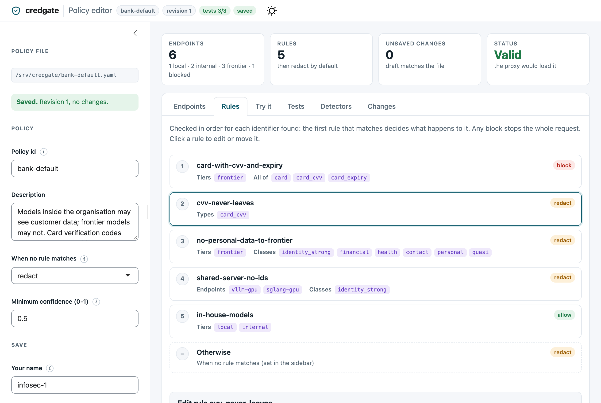
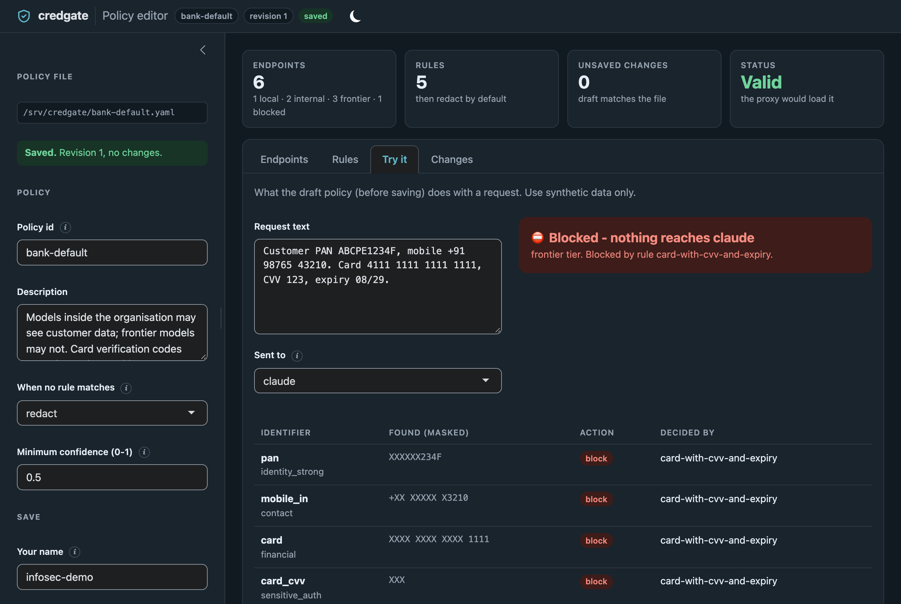

---
date:
  created: 2026-11-03
authors:
  - bharat
categories:
  - Proxy
  - Claude Code
slug: claude-code-without-a-pan
draft: false
description: Running Claude Code on Indian customer data, with every PAN, Aadhaar and mobile number tokenised or redacted before it leaves the machine, and an audit trail to prove it.
---

# Using Claude Code on Indian bank data without sending a single PAN

AI coding assistants are most useful exactly where the data is most
sensitive. In a bank or an NBFC, the notebooks, logs and call notes that
Claude Code reads are full of PAN, Aadhaar and mobile numbers - and RBI
guidance, the DPDP Act and PCI DSS all say those should not reach an
external model.

This post shows Claude Code running through **credgate**, an open-source
proxy that applies a policy to every request: identifiers are tokenised or
redacted before anything leaves the machine, the real values are put back
into the answer for you, and every decision is written to a tamper-evident
audit log.

<!-- more -->

## The setup: one environment variable

Claude Code sends its model requests to whatever `ANTHROPIC_BASE_URL` points
at. Point it at the credgate proxy:

```sh
pip install credgate
credgate proxy serve --policy bank.yaml --audit audit.jsonl --default-endpoint claude
ANTHROPIC_BASE_URL=http://127.0.0.1:8790 claude
```

Nothing else changes for the user: Claude Code works as usual, signed in to
their own account. The proxy listens on the analyst's machine only
(`127.0.0.1`), and `--default-endpoint claude` sends Claude Code's own model
names to the endpoint called `claude` in the policy.

## The policy: what may go where

The policy is a short YAML file that InfoSec owns. Endpoints have a tier -
`local` (the analyst's machine), `internal` (models the bank runs) or
`frontier` (external providers) - and rules decide what happens to each kind
of identifier, first match wins:

```yaml
destinations:
  claude: {tier: frontier, provider: anthropic, url: "https://api.anthropic.com/v1"}
rules:
  - id: card-with-cvv-and-expiry
    when: {tiers: [frontier], all_of: [card, card_cvv, card_expiry]}
    action: block
  - id: ids-tokenised
    when: {tiers: [frontier], classes: [identity_strong]}
    action: tokenise
  - id: contact-redacted
    when: {tiers: [frontier], classes: [contact, financial, personal]}
    action: redact
default_action: redact
```

**Tokenise** replaces a value with a token such as `[PAN_k3xq…]` that the
proxy can turn back into the real value in the answer. **Redact** replaces
it with a label such as `[MOBILE_IN]`, and the value is gone for good.
**Block** refuses the whole request - here, a card number together with its
CVV and expiry never reaches an external model at all.

InfoSec does not have to edit YAML by hand. credgate's policy editor shows
the rules in the order they are checked, and every save raises the revision
and records who changed what, and why:



Its **Try it** tab runs the unsaved policy on sample text before anyone
saves it. A card with its CVV and expiry, sent to `claude`, is blocked, and
every value is masked even on this screen:



## What happened

I asked Claude Code (2.1.309) to repeat a sentence with a synthetic PAN and
mobile number:

> Repeat this sentence exactly and say nothing else: The customer PAN is
> ABCPE1234F and mobile 9876543210.

Claude Code answered:

> The customer PAN is ABCPE1234F and mobile [MOBILE_IN]

The PAN is back, because it was tokenised: Claude saw only the token, and the
proxy restored the value in the answer on its way back to me. The mobile
number was redacted, so Claude never saw it and there was nothing to restore.

The audit log has a record for each request, with no values in it (the
user name shortened here):

```json
{"seq": 3, "time": "2026-11-02T13:38:39.222Z", "actor": "analyst",
 "policy": {"id": "live-check", "revision": 1},
 "destination": {"name": "claude", "tier": "frontier", "provider": "anthropic"},
 "allowed": true, "blocked_by": [],
 "items": [
   {"type": "pan", "action": "tokenise", "rule": "ids-tokenised"},
   {"type": "mobile_in", "action": "redact", "rule": "contact-redacted"},
   {"type": "person_name", "action": "redact", "rule": "contact-redacted"}],
 "prev": "c4ef87f7…"}
```

Two things in it surprised me:

- **A name was redacted that I never typed.** Claude Code adds its own
  context to every request - a system prompt and details about the working
  environment, which here included names and e-mail addresses. The proxy
  checks everything that goes out, not only the prompt, so those were
  redacted too.
- **Every record names the rule that decided it**, and `prev` holds the hash
  of the record before. Edit, delete or reorder a record and
  `credgate.audit_verify()` reports exactly where the chain breaks - evidence
  an auditor can check without trusting the person who kept the log.

## How it holds up

- **Streaming.** Claude Code streams its answers, and a token can arrive
  split across pieces (`[PAN_` in one, `k3xq…]` in the next). The proxy holds
  back a piece that could be the start of a token until the next one shows
  whether it is, so values are restored correctly while the answer streams.
- **Fails closed.** If detection, the policy or the audit record fails,
  nothing is sent. Images and files, which credgate cannot check, are
  refused rather than sent unchecked.
- **Checked under load.** In the published benchmark the proxy handled
  tens of thousands of requests with no errors, no wrong answers and no
  identifier reaching the endpoint; one worker passes on about 9,000
  streamed pieces a second.
- **Not only Claude Code.** The same proxy speaks the OpenAI and Ollama APIs,
  so VS Code Copilot Chat (with your own models), Open WebUI, ellmer and the
  SDKs go through it the same way.

## What it does not do

credgate is alpha, and honest about its limits:

- **It only governs what goes through it.** Network rules, not credgate,
  must make the proxy the only way to reach external models.
- **Names without a cue are often missed.** "Name: Lakshmi Verma" is found;
  "Lakshmi Verma called about her loan" is not yet. Prefer policies that
  redact free text for external models.
- **It handles accidental variation, not evasion.** Indic digits, hidden
  characters and mixed case are caught; someone deliberately spelling out a
  PAN letter by letter is not.

## Try it

credgate is open source (Apache-2.0), in Python and R, and runs fully
offline:

- Install: `pip install credgate` (and `pip install 'credgate[server]'` for
  a shared proxy on uvicorn)
- Guide: [The proxy](../../proxy.md), including Claude Code and Copilot Chat
- Code and issues: [github.com/dwarpal/credgate](https://github.com/dwarpal/credgate)

All values in this post are synthetic.
