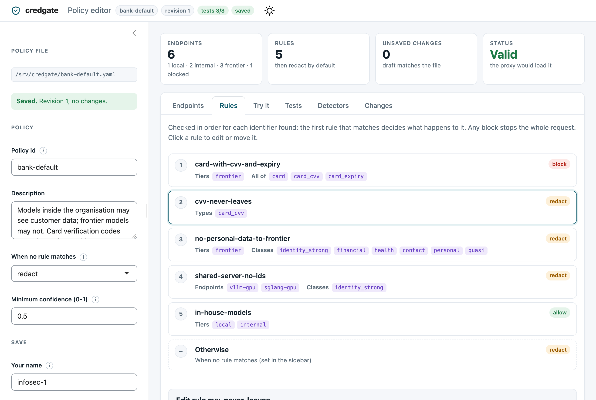
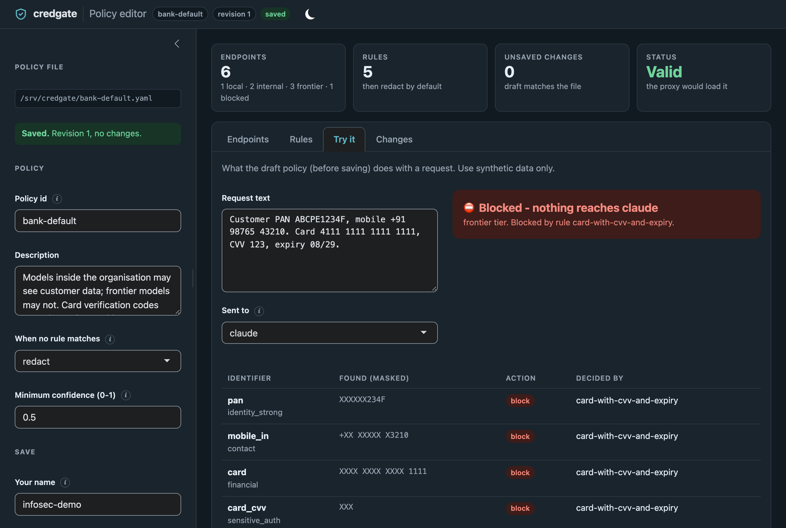

---
date:
  created: 2026-11-06
authors:
  - bharat
  - aishwarya
categories:
  - R
  - Policy editor
slug: shiny-policy-editor
draft: true
description: A Shiny app that lets InfoSec decide which language models may see which personal data, test the decision before saving it, and keep a tamper-evident record of every change - without editing YAML.
---

# A Shiny app for InfoSec: which models may see which data

Once a bank lets analysts use language models, someone has to decide which
models may see what. Customer PANs to the in-house model on the analyst's
laptop: probably fine. To a shared GPU server: perhaps not. To an external
provider: no. A card number with its CVV: never. That someone is usually
InfoSec or compliance, and they should not have to edit YAML to say it.

[credgate](https://github.com/dwarpal/credgate) keeps these decisions in a
**policy**, and its R package includes a Shiny app to edit one. This post
walks through it.

<!-- more -->

## The policy

A policy lists the model endpoints requests may go to, each with a tier -
`local` (the analyst's machine), `internal` (models the organisation runs)
or `frontier` (external providers) - and rules, checked in order, that
decide what happens to each identifier found: allow it, redact it, tokenise
it, or block the whole request.

```r
library(credgate)
policy <- cg_policy("bank-default.yaml")
d <- policy_decide(policy, "Card 4111 1111 1111 1111, CVV 123, expiry 08/29", "claude")
d$allowed      # FALSE
d$blocked_by   # "card-with-cvv-and-expiry"
```

Loading is strict: an unknown field, tier or identifier type is an error,
never a silent "allow".

## The editor

```r
# install.packages(c("shiny", "bslib"))
policy_editor("bank-default.yaml")
```



- **Endpoints** and **Rules**: add, change, reorder. The first rule that
  matches decides, so order matters; moving a rule shows straight away what
  changes.
- **Try it**: paste a synthetic sample, pick an endpoint, and see the
  decision on the unsaved policy - each identifier, its confidence, why it
  was found, the action and the rule that decided it. It also lists what
  looked like an identifier but was *not* reported, and why (a failed
  checksum, a missing keyword, a confidence below the minimum).
- **Tests**: once a decision is right, save it as a test. Every later change
  runs the tests first; a change that breaks one cannot be saved without
  saying why.
- **Detectors**: write and try custom detectors - loan account numbers,
  staff codes - with a form that generates the YAML.
- **Changes**: what differs from the saved file, and the change log.



## Tests: the behaviour that was agreed

```yaml
# bank.tests.yaml, beside the policy
kind: credgate-policy-tests
version: 1
tests:
  - id: card-blocked-for-claude
    endpoint: claude
    text: Card 4111 1111 1111 1111, CVV 123, expiry 08/29
    expect: {allowed: false, blocked_by: [card-with-cvv-and-expiry]}
```

```r
run_policy_tests("bank.yaml")[, c("id", "passed")]
#>                        id passed
#> 1 card-blocked-for-claude   TRUE
```

The same tests run in CI with `credgate policy test`, and the proxy refuses
to load a new policy revision whose tests fail.

## Every save is on record

Saving raises the policy's revision and appends who saved it, when, why and
what changed to a change log beside the policy. Each entry carries the hash
of the one before, so an entry edited or removed afterwards is detected.

```r
x <- yaml::read_yaml("bank.yaml")
x$destinations$copilot$blocked <- FALSE
policy_diff(yaml::read_yaml("bank.yaml"), x)
#> [1] "endpoint copilot: blocked true -> false"

policy_write(x, "bank.yaml", user = "priya", note = "CHG-1042 Copilot approved for code")
h <- policy_changes("bank.yaml")
h[, c("revision", "user", "note")]
#>   revision  user                               note
#> 1        2 priya CHG-1042 Copilot approved for code
attr(h, "intact")
#> [1] TRUE
```

## For a whole team

With a users file, the editor shows each person what their role allows,
and refuses the rest on the server:

- **admins** (InfoSec) change the policy;
- **auditors** see everything and change nothing;
- **users** (analysts) try the saved policy, see the tests and their own
  activity, and manage their own key for the credgate proxy - but not the
  policy's make-up.

Behind single sign-on (OAuth2 Proxy, Keycloak, a web server's SSO module),
the signed-in name comes from a header: see the
[deployment guide](../../../deployment.md). The editor loads nothing from
the internet, so it runs air-gapped.

The Python package has the same app (`credgate editor`), on the same files,
for teams without R.

## Try it

credgate is open source (Apache-2.0) and alpha. If you look after AI
governance or data protection, we would like to hear what is missing:
open a [discussion](https://github.com/dwarpal/credgate/discussions) or an
[issue](https://github.com/dwarpal/credgate/issues/new/choose).

- Install from [R-universe](https://dwarpal.r-universe.dev/credgate)
  (CRAN review in progress)
- [The policy editor guide](../../../policy-editor.md)

All values in this post are synthetic.
