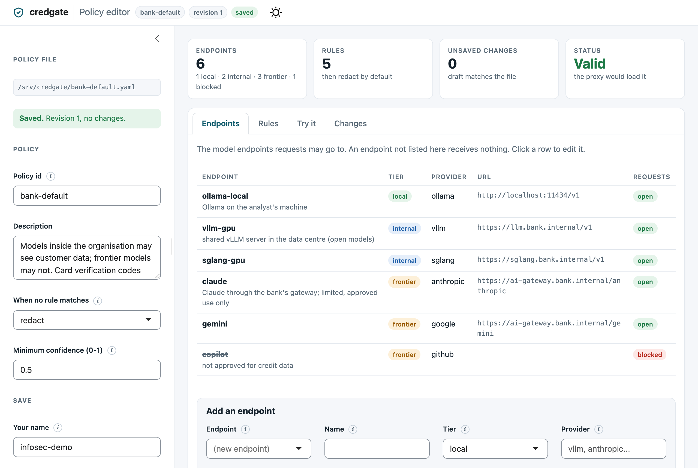
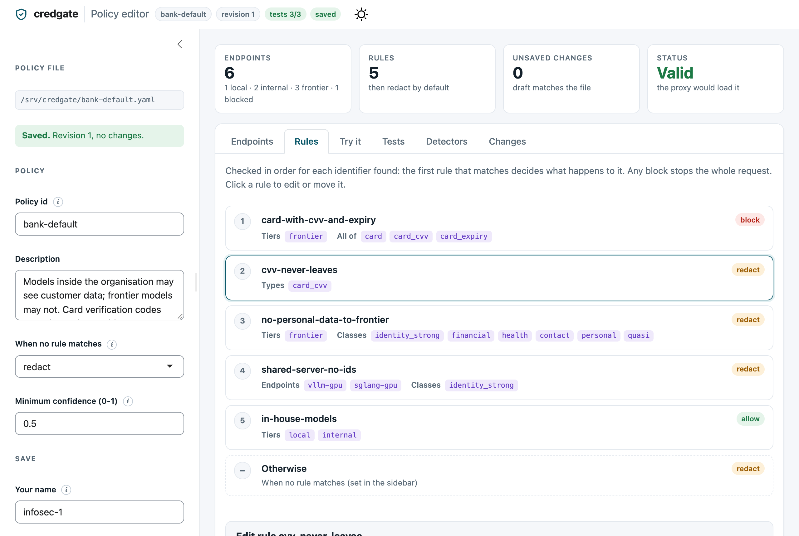
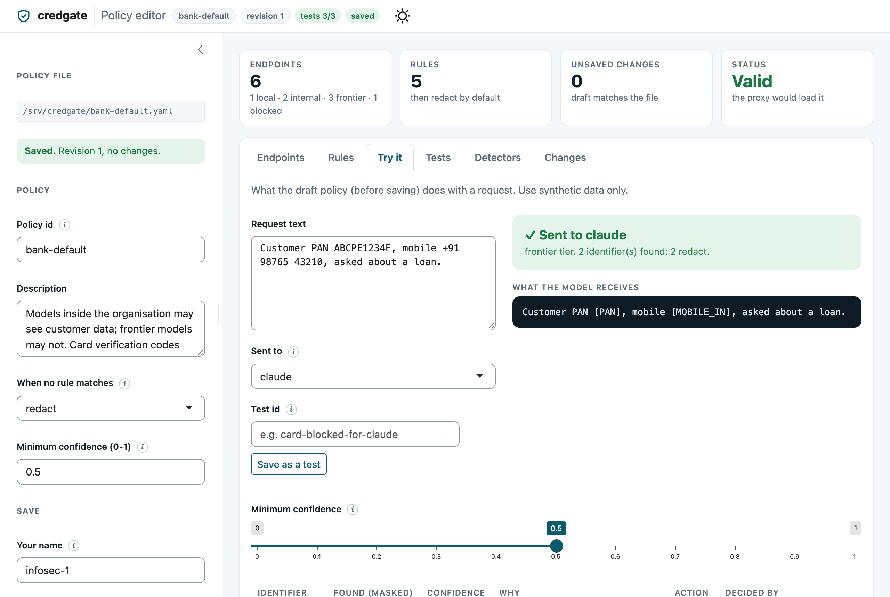
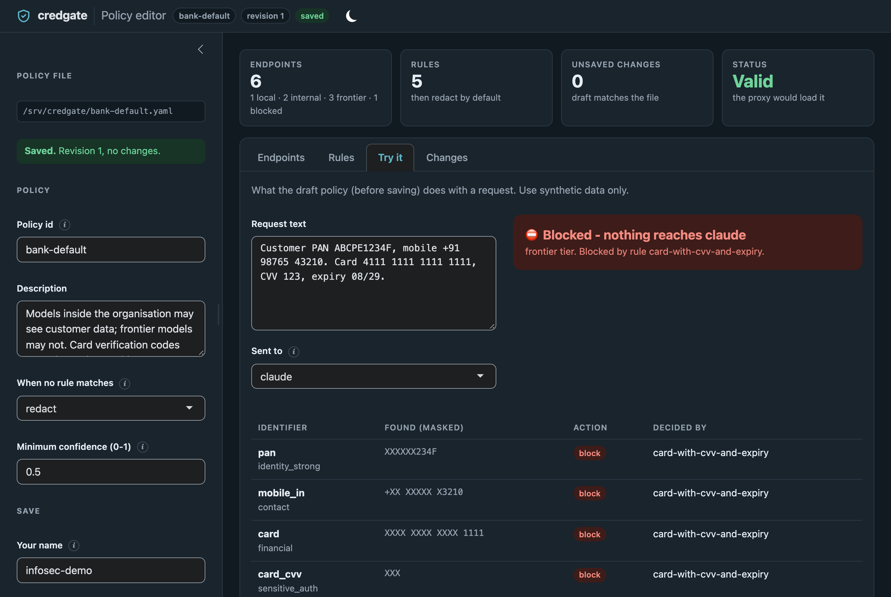
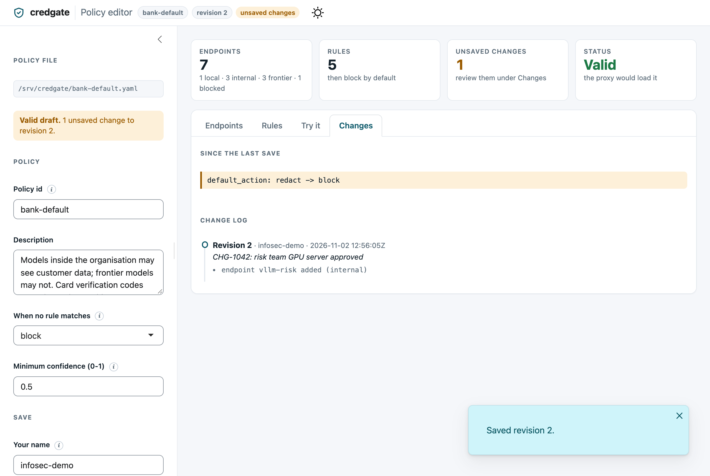

# Policy editor

The policy editor is a small web app (R Shiny) that lets InfoSec change a
policy without editing YAML by hand. It shows the policy's endpoints and its
rules in order. You can try a sample text against any endpoint. It shows what
changed before you save, and keeps a history of every save: who saved it,
when, why, and what changed. It has light and dark themes (following the
system setting, with a switch in the header), works on narrow screens, and
explains every field in a tooltip. It loads nothing from the internet, so it
runs on air-gapped machines.



```r
# install.packages(c("shiny", "bslib"))
credgate::policy_editor("bank-default.yaml", user = "infosec-1")
```

## What it does

| Rules, in the order they are checked | Try it: what a model would receive |
|---|---|
|  |  |
| **Try it, blocked** (dark theme) | **Changes and the change log** |
|  |  |

- **Endpoints**: add, change, block or remove the model endpoints that
  requests may go to. An endpoint that a rule still names cannot be removed.
  If you rename an endpoint, the rules that name it are updated too.
- **Rules**: add, change, remove and reorder rules. The first rule that
  matches decides the action, so order matters. Move a rule up or down to
  change it.
- **Try it**: paste a sample text (use synthetic data), pick an endpoint and
  see what the unsaved policy would decide, and which rule decided it.
  Detected values are shown masked. Each match shows its confidence and
  why it was found (the pattern, the checksum, the keyword nearby). **Not
  reported** lists what looked like an identifier but was dropped, and why:
  a failed checksum (a mistyped card number), a keyword the type needs ("a/c"
  for an account number), a confidence below the minimum, or a more
  confident overlapping match. The minimum-confidence slider is the policy's
  own setting: drag it to see what would be caught or let through.
- **Tests**: sample requests and what the policy must do with them (see
  [Policy tests](#policy-tests) below), run against the unsaved policy on
  every change. The header shows the score, such as "tests 3/3".
- **Detectors**: a workbench for the policy's [custom
  detectors](custom-detectors.md). Edit a detectors file named in the
  policy, or start a new one beside it, and see, as you type, what it finds
  in a sample text (highlighted, with confidence and reasons, and what was
  dropped and why) and whether each of its `examples` holds - a `match`
  example that is missed or a `no_match` example that is matched shows as
  failing. **Add a detector from a form** writes the YAML for you from an
  id, class, pattern, keywords and examples; edit it further by hand if you
  need fragments or lists. Saving checks the file exactly as credgate loads it, writes it,
  loads it into the editor and, for a new file, adds it to the policy's
  `detectors` list. Save a new policy revision afterwards, so the audit log
  shows that the detectors changed.
- **Changes**: what is different from the saved file, and the history of
  saves. The history is hash-chained like the audit log, so an entry that was
  edited or removed afterwards shows as broken.

**Save** stays disabled until the policy is valid and has changes, and
while a test fails. The
policy is checked exactly as the proxy loads it, so the editor can never save
a policy that the proxy would refuse. Each save raises the policy's
`revision` by one. The proxy and the audit log record that revision with
every decision.

## Files

| File | What it holds |
|---|---|
| `bank-default.yaml` | The policy, written in a fixed layout |
| `bank-default.changes.jsonl` | One line per save: time, user, note, revisions, changes |
| `bank-default.tests.yaml` | The policy's tests (optional) |

Comments in a policy file are **not kept** when the editor saves it. Put
explanations in the `description` fields of the policy, its endpoints and
its rules, which are kept.

From R, without the app:

```r
policy <- yaml::read_yaml("bank-default.yaml")
policy$destinations$copilot$blocked <- FALSE
policy_diff(yaml::read_yaml("bank-default.yaml"), policy)
policy_write(policy, "bank-default.yaml", user = "infosec-1", note = "Copilot approved")
policy_changes("bank-default.yaml")
```

## Policy tests

A rule that looks harmless can change what happens to a request it was not
meant for: rules are checked in order, and the first match decides. Policy
tests pin down the behaviour that was agreed - "full card details never
reach Claude", "PAN is redacted for frontier models" - so a later change
that breaks it is caught before it is saved, not after a request leaks.

They live beside the policy, in `bank-default.tests.yaml`:

```yaml
kind: credgate-policy-tests
version: 1
tests:
  - id: card-blocked-for-claude
    description: Full card details never reach a frontier model
    endpoint: claude
    text: Card 4111 1111 1111 1111, CVV 123, expiry 08/29
    expect:
      allowed: false
      blocked_by: [card-with-cvv-and-expiry]
  - id: pan-redacted-for-claude
    endpoint: claude
    text: Customer PAN ABCPE1234F
    expect:
      allowed: true
      actions: {pan: redact}     # every PAN found gets this action
      absent: [aadhaar]          # these types must not be found
      # output: "Customer PAN [PAN]"   # the exact text sent, if you want it
```

Only `allowed` is required. The full format is in the
[specification](spec.md#policy-tests-credgate-policy-tests).

**In the editor**, the Tests tab runs them against the draft on every change
and shows each failure with its reason ("allowed: expected false, got
true"). In **Try it**, once the decision for a sample is right, give it an
id and press **Save as a test**: the text, endpoint, decision and the action
for each type found are added to the tests file. While a test fails, Save is
disabled. If the change is intended - the agreed behaviour itself changed -
tick **Save anyway** and say why under "Why this change"; the change log
records the reason and which tests were failing. Then update or remove the
test.

**In CI**, run them whenever the policy or its tests change:

```sh
credgate policy test --policy bank-default.yaml
# PASS  card-blocked-for-claude
# FAIL  pan-redacted-for-claude
#       pan: expected redact, got tokenise
# 1 passed, 1 failed
```

It exits with 1 if a test fails and 2 if the tests file is not valid.
`--tests` names another file, and `--detectors` loads custom detectors. From
code: `run_policy_tests("bank-default.yaml")` in R and
`credgate.run_policy_tests("bank-default.yaml")` in Python, which read the
same files and give the same results.

## Running it for a team

On Shiny Server or Posit Connect, put this in an `app.R`:

```r
credgate::policy_editor("/srv/credgate/bank-default.yaml",
                        user = Sys.getenv("SHINYPROXY_USERNAME", "unknown"))
```

Without `user`, the editor fills in the signed-in user that Shiny reports
(`session$user`), or else the operating-system account. The name field stays
editable, so treat it as a record of who said they saved it. Rely on the
server's sign-in to control who can reach the app. Only people allowed to change the
policy should be able to reach the app. It writes the policy file, so run
it under an account that can write that file and nothing else.

The proxy reads the policy when it starts. Restart it (or its workers
behind the load balancer, one at a time) to apply a saved change.
